  
  &nbsp;&nbsp;
  
  &nbsp;&nbsp;
  

  <h1 align="center">Hi 👋🏻 I'm Isabelle Landini</h1>

  

    <strong>Junior Python Backend Developer</strong>
  

  
📍 Guaratinguetá - São Paulo, Brazil

  
  &nbsp;&nbsp;
  
  &nbsp;&nbsp;
  

<h2 align="left">About Me</h2>

  Junior Python Backend Developer with Full Stack Development training from EBAC and a focus on building APIs and backend applications. I maintain frontend development as a complementary skill and continue studying new technologies and tools to deepen my knowledge and expand my professional opportunities.
    
  I am organized, proactive, and adaptable, with a willingness to learn, take initiative, and collaborate. I am interested in exploring new technologies, getting familiar with different tools, and discovering new ways to solve problems through projects that challenge me and contribute to my professional growth. I have flexible availability and can adapt to changing priorities, unexpected situations, and deadlines while maintaining focus, organization, and commitment to deliverables. 

<h2 align="left">Tech Stack</h2>

  
  &nbsp;&nbsp;
  
  &nbsp;&nbsp;
  
  &nbsp;&nbsp;
  
  &nbsp;&nbsp;
  
  &nbsp;&nbsp;
  

<h2 align="left">Projects</h2>

<table>
  <tr>
    <td width="50%" valign="top">
        <h3>Books API</h3>
        
REST API for book management with HTTP Basic authentication, Redis caching, asynchronous tasks with Celery, and Kafka messaging.

        
Python · FastAPI · SQLAlchemy · Redis · Celery · Kafka

        
    </td>
    <td width="50%" valign="top">
        <h3>Focus API</h3>
        
API for tracking focus sessions, calculating metrics, and generating automated feedback based on business rules.

        
Python · FastAPI · SQLAlchemy · SQLite · Pydantic · Pytest

        
    </td>
  </tr>
  <tr>
    <td width="50%" valign="top">
        <h3>Tasks API</h3>
        
REST API with CRUD operations, HTTP Basic authentication, and SQLite persistence.

        
Python · FastAPI · SQLAlchemy · Pydantic · Docker Compose

        
    </td>
    <td width="50%" valign="top">
        <h3>Travel Portal</h3>
        
Complementary frontend project for exploring travel destinations through listings and detail pages.

        
Next.js · React · TypeScript · CSS Modules

        
        
    </td>
  </tr>
</table>

<h2 align="center">GitHub Statistics</h2>

  

 

  

