  
  &nbsp;&nbsp;
  
  &nbsp;&nbsp;
  

    <h1 align="center">Salut 👋🏻 Je suis Isabelle Landini</h1>
    

    <strong>Développeuse Backend Python Junior</strong>
    

    
📍 Guaratinguetá - São Paulo, Brésil

    
    &nbsp;&nbsp;
    
    &nbsp;&nbsp;
    

<h2 align="left">À propos de moi</h2>

  Développeuse Backend Python Junior, avec une formation en développement Full Stack à l'EBAC et spécialisée dans la création d'API et d'applications backend. Je maintiens le développement frontend comme compétence complémentaire et je continue à étudier de nouvelles technologies et de nouveaux outils afin d'approfondir mes connaissances et d'élargir mes possibilités professionnelles.
    
  Je suis organisée, proactive et adaptable, avec une facilité à apprendre, à prendre des initiatives et à collaborer. Je souhaite explorer de nouvelles technologies, découvrir différents outils et trouver de nouvelles façons de résoudre des problèmes à travers des projets qui me mettent au défi et contribuent à mon évolution professionnelle. Je dispose d'une disponibilité flexible et je sais m'adapter aux changements de priorités, aux imprévus et aux délais, tout en maintenant ma concentration, mon organisation et mon engagement envers les livrables.

<h2 align="left">Technologies</h2>

  
  &nbsp;&nbsp;
  
  &nbsp;&nbsp;
  
  &nbsp;&nbsp;
  
  &nbsp;&nbsp;
  
  &nbsp;&nbsp;
  

<h2 align="left">Projets</h2>

<table>
  <tr>
    <td width="50%" valign="top">
        <strong>Books API</strong>
        
API REST de gestion de livres avec authentification HTTP Basic, cache Redis, tâches asynchrones avec Celery et messagerie Kafka.

        
Python · FastAPI · SQLAlchemy · Redis · Celery · Kafka

        
    </td>
    <td width="50%" valign="top">
        <strong>Focus API</strong>
        
API permettant d'enregistrer des sessions de concentration, de calculer des indicateurs et de générer des retours automatiques à partir de règles métier.

        
Python · FastAPI · SQLAlchemy · SQLite · Pydantic · Pytest

        
    </td>
  </tr>
  <tr>
    <td width="50%" valign="top">
        <strong>Tasks API</strong>
        
API REST avec opérations CRUD, authentification HTTP Basic et persistance des données avec SQLite.

        
Python · FastAPI · SQLAlchemy · Pydantic · Docker Compose

        
    </td>
    <td width="50%" valign="top">
        <strong>Portail de voyages</strong>
        
Projet frontend complémentaire permettant de découvrir des destinations touristiques à travers des listes et des pages de détails.

        
Next.js · React · TypeScript · CSS Modules

        
        
    </td>
  </tr>
</table>

<h2 align="center">Statistiques GitHub</h2>

  

  

