

  
  &nbsp;&nbsp;
  
  &nbsp;&nbsp;
  

  <h1 align="center">Olá 👋🏻 Eu sou Isabelle Landini</h1>

  

    <strong>Desenvolvedora Backend Python Júnior</strong>
  

  
📍 Guaratinguetá - São Paulo, Brasil

  
  &nbsp;&nbsp;
  
  &nbsp;&nbsp;
  
  

<h2 align="left">Sobre Mim</h2>

  Desenvolvedora Backend Python Júnior, com formação em Desenvolvimento Full Stack pela EBAC e foco na construção de APIs e aplicações Backend. Mantenho o Frontend como conhecimento complementar e sigo estudando novas tecnologias e ferramentas para fortalecer meu aprendizado e ampliar minhas possibilidades de atuação.
    
  Sou organizada, proativa e adaptável, com facilidade para aprender, iniciativa e disposição para colaborar. Tenho interesse em explorar novas tecnologias, conhecer diferentes ferramentas e descobrir novas formas de resolver problemas por meio de projetos que me desafiem e contribuam para a minha evolução. Tenho disponibilidade e flexibilidade de horários, além de facilidade para lidar com mudanças de prioridade, imprevistos e prazos, mantendo o foco, a organização e o compromisso com as entregas.

<h2 align="left">Stack</h2>

  
  &nbsp;&nbsp;
  
  &nbsp;&nbsp;
  
  &nbsp;&nbsp;
  
  &nbsp;&nbsp;
  
  &nbsp;&nbsp;
  

<h2 align="left">Projetos</h2>

<table>
  <tr>
    <td width="50%" valign="top">
      <h3>API Livros</h3>
      
API REST de gerenciamento de livros com autenticação HTTP Basic, cache Redis, tarefas assíncronas com Celery e mensageria Kafka.

      
Python · FastAPI · SQLAlchemy · Redis · Celery · Kafka

      
    </td>
    <td width="50%" valign="top">
      <h3>API Foco</h3>
      
API para registrar sessões de foco, calcular métricas e gerar feedback automático com regras de negócio.

      
Python · FastAPI · SQLAlchemy · SQLite · Pydantic · Pytest

      
    </td>
  </tr>
  <tr>
    <td width="50%" valign="top">
      <h3>API Tarefas</h3>
      
API REST com operações CRUD, autenticação HTTP Basic e persistência em SQLite.

      
Python · FastAPI · SQLAlchemy · Pydantic · Docker Compose

      
    </td>
    <td width="50%" valign="top">
      <h3>Portal de Viagens</h3>
      
Projeto frontend complementar para explorar destinos turísticos por listagem e páginas de detalhes.

      
Next.js · React · TypeScript · CSS Modules

      
      <a href="https://portal-viagens-nextjs.vercel.app/">
        
      </a>
    </td>
  </tr>
</table>

<h2 align="center">Estatísticas do GitHub</h2>

  

 

  

